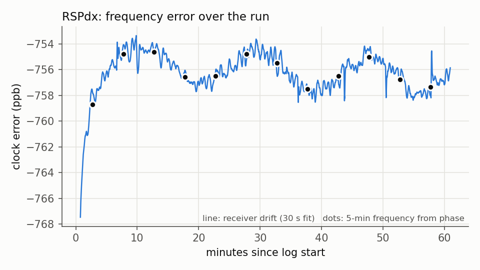
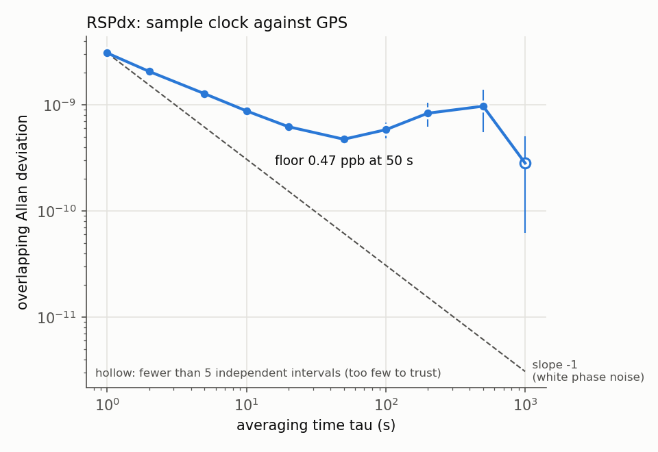
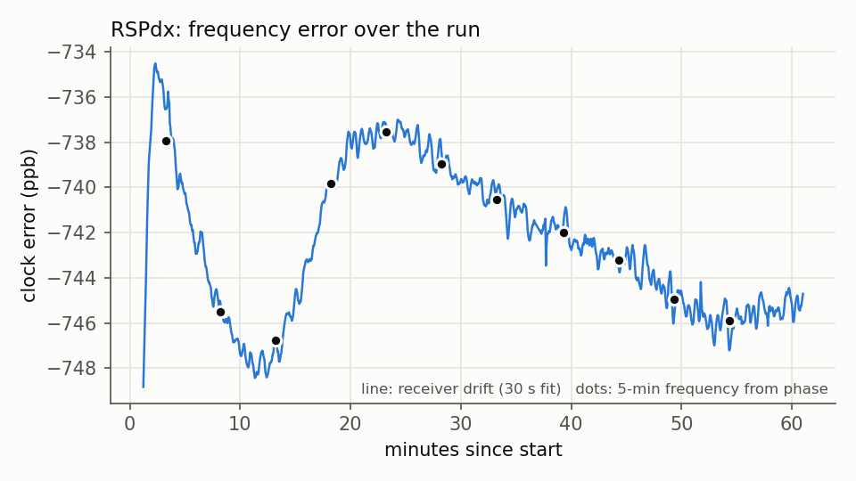
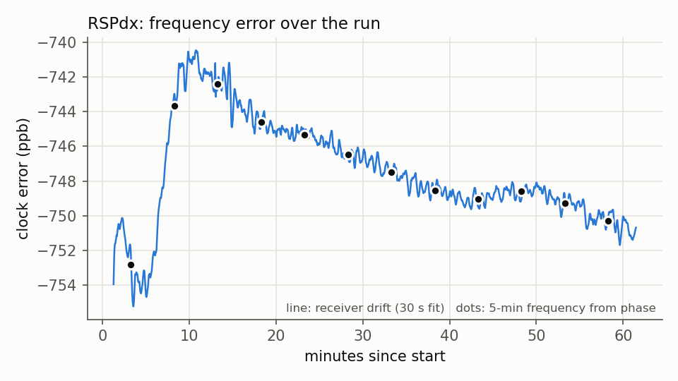

# The RSPdx's crystal as a clock

*Measured 2026-10-14 and 2026-10-16 with gr-gpsrx on an SDRplay RSPdx (USB-powered, active GPS
patch antenna on Antenna B, bias-T on). Software-GPSDO idea after
[hackrf-gpsdo](https://github.com/willcode/hackrf-gpsdo): there is no reference locked here;
the clock's error is measured against GPS, logged, and subtracted in software.*

**The one-liner for other projects:**

> **RSPdx clock error = −747 ppb ± 12, measured 2026-10-14/16, warm-up 3 minutes.**

That is the sample clock. The tuner's LO at 1575 MHz reads about 8 ppb less negative (−739);
see test 5. Within one hour the number holds to about ±3 ppb; the ±12 covers every reading over
two days of different room conditions. Apply it as a digital shift, not through the driver's
`ppm` setting (test 4).

## Tools

| tool | what it does |
|---|---|
| `tools/clocklog.py` | the receiver live, one CSV row per second: UTC, GPS time, satellites, fix valid, clock drift (ppb), fix residual, raw clock offset (phase), resync flag. No position columns; the position goes only to `--fix-file`. Writes the bias-T on and **reads it back** before streaming (stops if it does not read `true`); refuses the bias-T on any port but Antenna B. `--obs-file` logs each channel's raw carrier Doppler with no fix needed; `--rinex-file` writes RINEX 3 observations. |
| `tools/allan.py` | the analysis: overlapping Allan deviation from the clock **phase** on an exact 1 s GPS grid; 5-minute block frequencies and a trend verdict; `--warmup` (time to settle within 10 ppb of the final value); `--temps` (drift against a temperature log); `--t0` (count from the plug-in). Checked against white-FM and white-PM theory to 1-2 %. |
| `tools/wwv.py` | WWV / CHU carrier offset by one long FFT, tuned 25 kHz off the carrier, decimated in memory (no IQ written); bias-T written **off** and read back first. `--soft-ppb` applies the software correction; `--corr-ppm` the driver's. |
| `tools/doppler_check.py` | the one-satellite method: each satellite's measured Doppler minus the Doppler predicted from its ephemeris and a known position, giving the crystal's error from any single satellite with no fix. |

Where the drift comes from: `pvt_solver.py` `_timing()` fits a straight line to (sample / fs − GPS
time) over the last 30 s of fixes. Neighbouring values share most of their data, which is why the
statistics here are computed from the raw phase, not from that column.

## Test 1 - baseline hour

Wednesday afternoon, radio already on for hours, hot day. 3643 of 3661 seconds had a valid fix
(99.5 %), 5-8 satellites (median 7), residual rms median 2.3 m, no lost samples.

| | |
|---|---|
| frequency error from the hour's phase | **−756.0 ppb** |
| drift column: mean / SD | −756.2 / 1.6 ppb |
| drift column: min / max | −767.5 (first 3 min) / −753.4 ppb |
| trend over the last 30 min | −3.3 ± 2.3 ppb/h: not significant; **settled** |



The first ~4 minutes climb from −767 to −755 (the radio had idled a few minutes before the run:
every restart shows a transient, see test 3). After that a ±1.5 ppb wobble with a ~20-minute
period, which test 3 ties to the air conditioning.

## Test 2 - Allan deviation

Overlapping Allan deviation of the fractional frequency, from the baseline hour's phase:

| τ (s) | 1 | 2 | 5 | 10 | 20 | **50** | 100 | 200 | 500 | 1000 |
|---|---|---|---|---|---|---|---|---|---|---|
| ADEV (ppb) | 3.08 | 2.06 | 1.27 | 0.88 | 0.62 | **0.47** | 0.58 | 0.83 | 0.97 | 0.28 ± 0.22* |

\* fewer than two independent 1000 s intervals fit in an hour; not trustworthy.



**Averaging stops helping at about 50 s** (0.47 ppb). Below that the GPS measurement noise
averages down close to the white-phase-noise slope; above it the crystal's own wander takes
over. To measure the clock now, average 30-60 s. (The cold-start hour, with its larger wander,
gives 0.72 ppb at 50 s.)

## Test 3 - warm-up

Two starts were logged, the drift counted from the moment streaming began:

| start | before it | first 3 min | after | settled within 10 ppb at |
|---|---|---|---|---|
| Wed evening | 47 min unplugged, room cooled by AC | −753, flat | jump of ~13 ppb to −741 at 6-10 min, then a slide back to −750 by 60 min | 1.3 min |
| Fri morning (cold) | unplugged and PC off overnight | jump of **28 ppb** in 2.5 min (−763 → −735) | slide to −748 by 13 min, back up to −738 by 21 min, −745 at 60 min | **3.0 min** |





So: **wait 3 minutes after plugging in, then apply the correction.** The total movement during
warm-up is 15-30 ppb, i.e. the correction is already 95 % right from the first second; the three
minutes buy the last 10 ppb. Every restart after an idle spell shows a transient of 10-30 ppb that
lasts 3-10 minutes, even when the radio was off for only a minute.

Caveats: the cold start had sat powered-but-idle for 3.5 minutes (plugged in during boot, no
firmware loaded) before streaming began; the case was 73 °F at plug-in against ~76 °F running.
The radio's own temperature is not reported by the driver, and the ±5 ppb wobble in both runs
tracks the AC cycling rather than the case readings.

## Test 4 - WWV truth check

Passive TV antenna on Antenna A (bias-T off, read back), GPS antenna still on B; a 10-minute GPS
reading before and after.

| | reading | vs GPS at the time |
|---|---|---|
| GPS before (10 min) | −758 → −748 ppb (still settling after an idle spell) | |
| WWV 10 MHz, 2 min | +7.55 Hz = **−755 ppb** | 3 ppb |
| WWV 10 MHz, later readings | −768 / −774 / −775 ppb | |
| WWV 5 / 10 / 15 MHz back to back | −822 / −768 / −724 ppb | |
| GPS after (10 min) | −746 ppb (SD 0.6) | |

The three WWV frequencies disagree by 0.2-0.4 Hz. A pure clock error gives the same ppb on all
three, so something else adds a few tenths of a Hz at night: ionospheric Doppler on the skywave,
or the tuner's synthesizer not landing exactly on the requested frequency (test 5 suggests the
latter is real). An unexplained drifting tone also sits near each carrier at roughly the mirror
offset. **WWV confirms the GPS number to ±20-30 ppb at night**; GPS remains the precise measurement.
A daytime rerun at 10 and 15 MHz would tighten this.

**Does one number fix the radio at both 10 MHz and 1575 MHz?** Yes, applied in software: a
digital shift by the GPS value took the 10 MHz carrier from 7.55 Hz off to 0.19 Hz off (97.5 %
removed), the residual within what skywave can resolve.

**Do not use the driver's `ppm` setting.** It is nonlinear (WWV 10 MHz, expected vs removed):
−0.5 ppm removed 4.66 Hz of 4.99; −0.755 removed 6.70 of 7.53; −1.0 removed 22.2 of 9.98. Tune to
the nominal frequency and shift digitally.

## Test 5 - one-satellite frequency mode

gr-gpsrx had no known-position mode (the solver needs four satellites; velocity is not solved), so
`tools/doppler_check.py` was added rather than changing the receiver: for a receiver that is not
moving, each satellite's measured Doppler minus the Doppler predicted from its ephemeris and the
known position leaves one common term, the crystal's error (eps = −residual / f_L1). A position
good to a few km is enough (a km is ~0.1 Hz, under 0.1 ppb), and with no fix the PC's NTP clock
stands in for GPS time (a second of error is under 0.5 ppb).

| data | result |
|---|---|
| 10 min, good sky, 6 satellites, 584 fixes | every satellite **alone** gives −743.5 ppb; they agree within 0.4 ppb second by second |
| same minutes, after warm-up: Doppler-only vs PVT drift | −739.1 vs −747.9 ppb: **9 ppb apart**, consistently (7 ppb on Wednesday's data too) |
| **antenna in a poor spot**: 10 min, mostly 1-2 satellites, 3 fixes in 600 s | an estimate every second; satellites tracked at the same moment agree to 0.5 ppb (median); the 10-minute mean −739.8 ppb matches the good-sky Doppler figure to 0.7 ppb |

The poor-spot run also showed the crystal moving −752 → −730 over its ten minutes (a restart
transient, test 3): the single-satellite tracker followed it like the full solution would.

The consistent 9 ppb between the two methods is real and has a plausible cause: the Doppler method
measures the **tuner's LO**, the PVT drift the **sample clock**. Both come from the same crystal,
but the LO goes through a synthesizer that lands on discrete steps, so it may sit ~14 Hz off the
exact 1575.42 MHz. Hence two numbers: **−747 ppb for the sample clock, about −739 for the LO at
L1**. Either is well inside the ±12 ppb band.

## Test 6 - temperature

Infra-red readings of the case (back, centre) during both warm-up runs spanned only 1.5 °C and
the fits disagree even on the sign (−1.0 and +1.7 ppb/°C). The drift reacts to the air over the
radio faster than the case surface does. **No ppb/°C is claimed.** A proper measurement needs a
sensor on the board, or a controlled 10 °C swing.

## Status of the premise

The brief said the RSPdx has no reference input. It does: a **REF IN** (MCX, next to the USB
socket, expecting 24 MHz). A GPS-disciplined 24 MHz there would replace all of this at about
1e-10. For the projects this measurement serves (TV, airband, LoRa, GPS) the software correction
is enough: ±12 ppb is ~9 Hz at 433 MHz, ~2.4 Hz at 120 MHz, ~7 Hz at 600 MHz and ~19 Hz at 1575 MHz.

## Reproducing

```
python tools/clocklog.py --seconds 3600 --csv /somewhere/private/clock.csv --fix-file /somewhere/private/fix.json
python tools/allan.py /somewhere/private/clock.csv --out /somewhere/private/report [--warmup --t0 <plug-in ISO time>]
python tools/wwv.py --freq 10e6 --seconds 120 [--soft-ppb -747]
python tools/clocklog.py --seconds 600 --csv c.csv --obs-file obs.csv --eph-file eph.json --fix-file fix.json
python tools/doppler_check.py obs.csv --eph eph.json --fix-file fix.json
```

Logs, fix files and ephemeris stores hold the position: keep them outside the repository.
